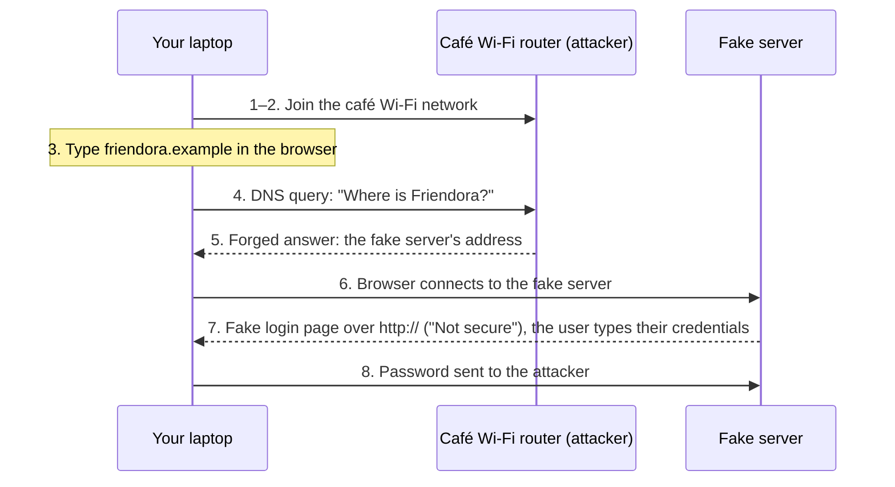

**English** · [Русский](./README.ru.md)

# DNS Hijacking Demo

A one-screen animated explainer that shows non-technical, Russian-speaking audiences how a rogue public Wi-Fi router can steal a password through DNS hijacking.

**Live demo:** https://dl-portfolio.github.io/dns-hijack-demo/

This is an independent demo. The café ("Lunabean Café") and the social network ("Friendora", at the reserved `friendora.example` domain) in the animation are fictional; any resemblance to real brands is unintended.

It is a static page (HTML, CSS and vanilla JavaScript with [anime.js](https://animejs.com/)) built for live streams and presentations: press one button and the attack plays out in eight steps, with almost no text to read. The on-screen text is in Russian.

<!-- TODO: demo GIF -->

## Quick start

Open the [live demo](https://dl-portfolio.github.io/dns-hijack-demo/), or open `index.html` locally in a browser, and press **▶️ Запустить** ("Start"). **🔄 Заново** ("Again") resets the animation.

No build step or server is needed, and all asset paths are relative, so the repository root can be served as-is (for example by GitHub Pages). The page loads anime.js 3.2.2 from cdnjs, so the browser needs an internet connection for the animation to run.

## How it works

`dns-hijack.js` runs a fixed sequence of anime.js animations over the network diagram in `index.html`, updating a status line at each step:

### Files

- `index.html`: the page and network visualisation
- `styles.css`: layout, animations and a narrower layout for screens up to 1200 px wide
- `dns-hijack.js`: the eight-step attack animation
- `images/`: PNG artwork for the servers

## Security notes and limits

- **Nothing is collected.** The "login form" fields are read-only and filled in by the script with a placeholder address and dots; the page sends no data anywhere.
- **What the fake page looks like.** The attacker cannot get a valid certificate for the real site, so the fake page is served over plain `http://`: the demo's address bar shows "⚠️ Не защищено" ("Not secure") and no padlock. A site using HTTPS (especially with HSTS) would show a certificate warning instead; the lesson is not to ignore either.
- **A padlock is not proof.** A padlock only means the connection is encrypted to *some* site, not that the site is genuine: an attacker can get a valid certificate for a look-alike domain they own. Check the address, not just the padlock.
- **Deliberately simplified.** The demo is about why you should not trust open networks or ignore browser warnings, not a literal account of attacking a modern site.
- **Third-party script.** anime.js 3.2.2 is loaded from cdnjs with a Subresource Integrity hash (`integrity` plus `crossorigin="anonymous"`), so the browser refuses a modified file. For offline or locked-down presentations, vendor the file locally.

## Licence

MIT. See [LICENSE](LICENSE).
