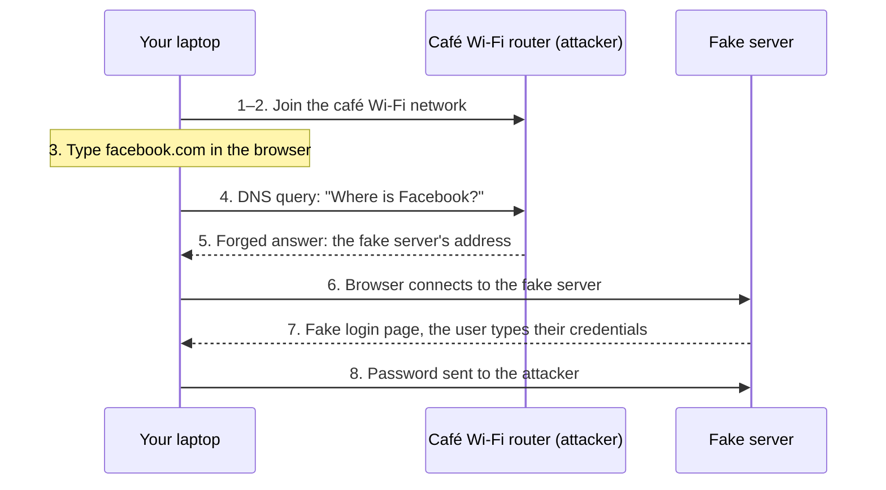

**English** · [Русский](./README.ru.md)

# DNS Hijacking Demo

A one-screen animated explainer that shows non-technical, Russian-speaking audiences how a rogue public Wi-Fi router can steal a password through DNS hijacking.

This is an independent demo and is not affiliated with Hacksplaining or with any company or brand shown in the animation.

It is a static page (HTML, CSS and vanilla JavaScript with [anime.js](https://animejs.com/)) built for live streams and presentations: press one button and the attack plays out in eight steps, with almost no text to read. The on-screen text is in Russian.

<!-- TODO: demo GIF -->

## Quick start

Open `index.html` in a browser and press **▶️ Запустить** ("Start"). **🔄 Заново** ("Again") resets the animation.

No build step or server is needed. The page loads anime.js 3.2.2 from cdnjs, so the browser needs an internet connection for the animation to run.

## How it works

`dns-hijack.js` runs a fixed sequence of anime.js animations over the network diagram in `index.html`, updating a status line at each step:

### Files

- `index.html`: the page and network visualisation
- `styles.css`: layout, animations and a narrower layout for screens up to 1200 px wide
- `dns-hijack.js`: the eight-step attack animation
- `images/`: PNG artwork for the servers

## Security notes and limits

- **Nothing is collected.** The "login form" fields are read-only and filled in by the script with a placeholder address and dots; the page sends no data anywhere.
- **Deliberately simplified.** The scenario leaves out HTTPS. In practice, a site served over HTTPS (especially with HSTS) would show a certificate warning rather than a padlock when DNS points to an impostor server; the demo is about why you should not trust open networks or ignore browser warnings, not a literal account of attacking a modern site.
- **Third-party script.** anime.js is loaded from a CDN without a Subresource Integrity hash. For offline or locked-down presentations, vendor the file locally.

## Licence

MIT. See [LICENSE](LICENSE).
